<div align="center">


# APEX · نمایشگاه دیجیتال ماشین‌های خاص

**از تماشای یک عکس تا کشف هر زاویه؛ یک تجربهٔ سینمایی، فارسی و تعاملی.**


[نمایش تصویری](#gallery) · [استودیوی 360°](#studio) · [ماشین‌ها](#collection) · [امکانات](#features) · [شروع سریع](#getting-started) · [ساختار پروژه](#architecture)

[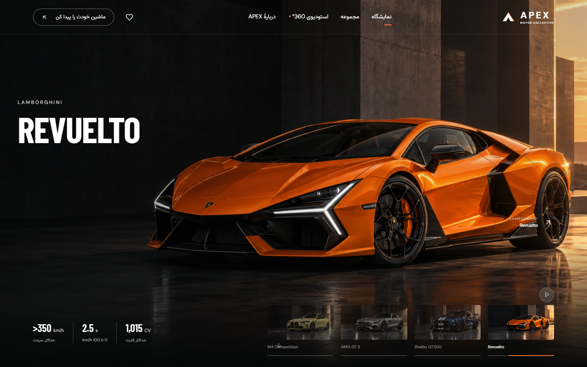](docs/screenshots/home.png)

</div>

نمایشگاه **APEX** با 12 ماشین، رابط فارسی و چیدمان راست‌چین ساخته شده است. ماشین‌ها را در مجموعه مرور کنید، مشخصاتشان را کنار هم ببینید و در استودیوی سه‌بعدی، دور ماشین بچرخید، رنگ بدنه را تغییر دهید یا بین نور روز و شب جابه‌جا شوید. نام مدل‌ها و برندها، اصطلاحات فنی و عددها انگلیسی باقی مانده‌اند.

> تصاویر این README از اجرای واقعی برنامه در Brave ثبت شده‌اند. عکس‌های تبلیغاتی ماشین‌ها با هوش مصنوعی ساخته شده‌اند؛ مدل‌های سه‌بعدی اثر هنرمندان مستقل‌اند. این پروژه یک دموی فرانت‌اند است و قیمت‌ها، کارکردها و فرم درخواست جنبهٔ نمایشی دارند.

| مجموعه | استودیوی سه‌بعدی | طراحی | تجربهٔ نمایش |
| :---: | :---: | :---: | :---: |
| **12 ماشین** از برندهای مختلف | **360°**، سه رنگ برای هر ماشین و دو فضای نورپردازی | فارسی و RTL، کارت‌های شیشه‌ای و بک‌گراند ثابت | هیروی خودکار، لودینگ واقعی و حالت مخصوص ضبط |

<a id="gallery"></a>
## نمایش تصویری پروژه

روی هر تصویر کلیک کنید تا نسخهٔ کامل آن باز شود.

### نمایشگاه؛ ماشین در مرکز توجه

هیروی تمام‌صفحه چهار ماشین منتخب دارد. عکس و نام بزرگ ماشین همراه یکدیگر عوض می‌شوند و خط زیر تصویر منتخب، زمان نمایش اسلاید را نشان می‌دهد. خط ابتدا سریع‌تر و در انتها آرام‌تر پر می‌شود؛ اسلایدها به‌صورت خودکار جلو می‌روند و امکان توقف یا انتخاب دستی هم وجود دارد.

<details>
<summary>یک اسلاید دیگر؛ Ford Mustang Shelby GT500</summary>
<br />

[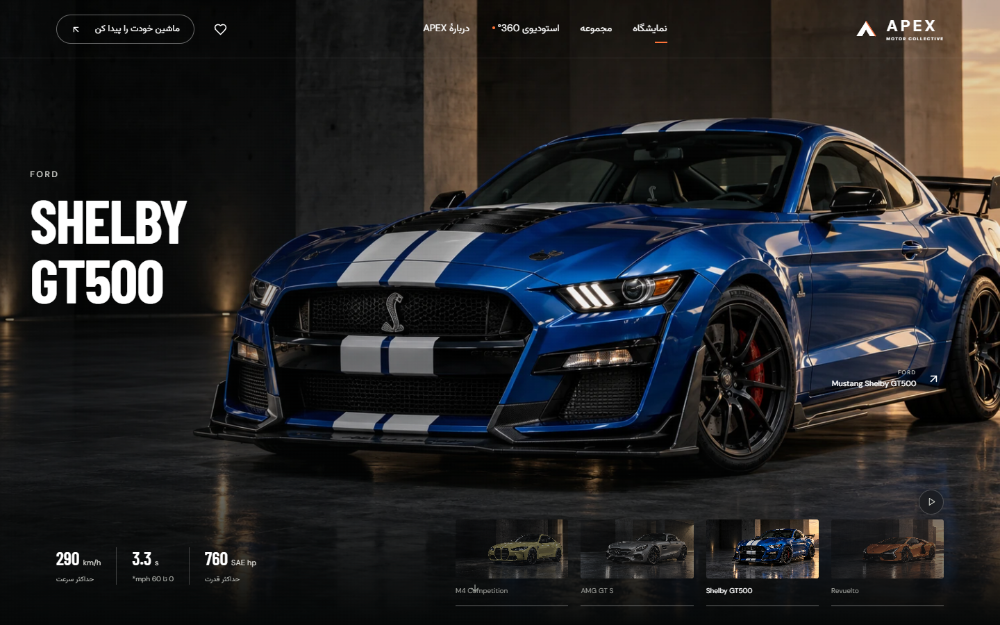](docs/screenshots/home-mustang.png)

</details>

### مجموعه؛ کارت‌های شیشه‌ای روی یک فضای ثابت

[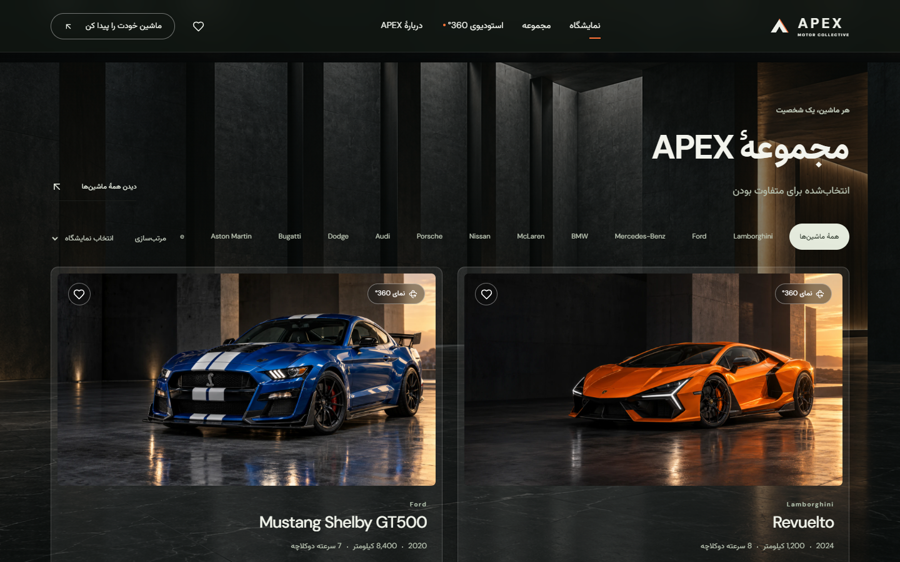](docs/screenshots/collection.png)

کارت‌ها روی تصویر ثابت یک فضای معماری اسکرول می‌شوند. با رسیدن به محدودهٔ دید، خود کارت محو و ظاهر می‌شود و عکس از پایین به بالا آشکار می‌شود. جست‌وجوی مدل یا پیشرانه، فیلتر برند، مرتب‌سازی، ذخیرهٔ ماشین و انتخاب برای مقایسه در دسترس‌اند.

<details>
<summary>نمای کامل کارت‌ها، قیمت و انتخاب برای مقایسه</summary>
<br />

[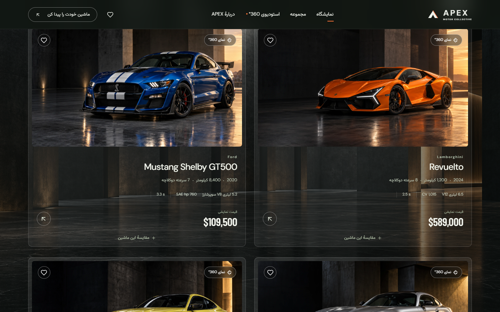](docs/screenshots/collection-cards.png)

</details>

<a id="studio"></a>
### استودیوی 360°؛ هر زاویه، یک نگاه تازه

[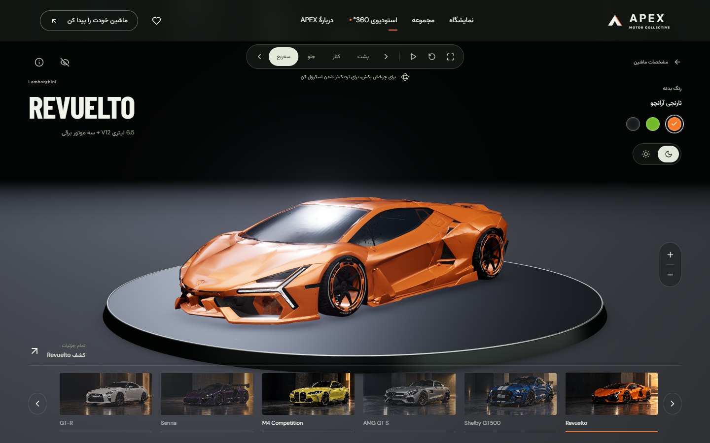](docs/screenshots/studio-dark.png)

ماشین‌ها روی یک استیج دایره‌ای با سایه و بازتاب نمایش داده می‌شوند. با ماوس یا لمس بچرخانید، برای نزدیک‌تر شدن زوم کنید و از نماهای آمادهٔ جلو، کنار، پشت و سه‌ربع استفاده کنید. صفحهٔ استودیو ارتفاع پنجرهٔ مرورگر را می‌گیرد؛ اسکرول روی صحنه به دوربین اختصاص دارد.

| فضای تاریک · McLaren Senna | فضای روشن · Porsche 911 Targa 4S |
| :---: | :---: |
| [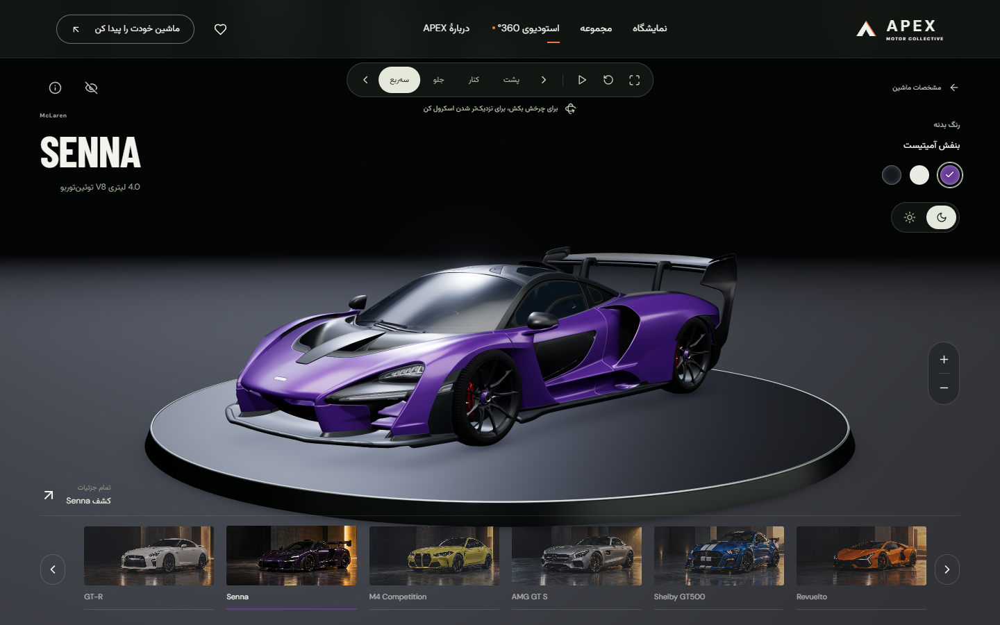](docs/screenshots/studio-senna.png) | [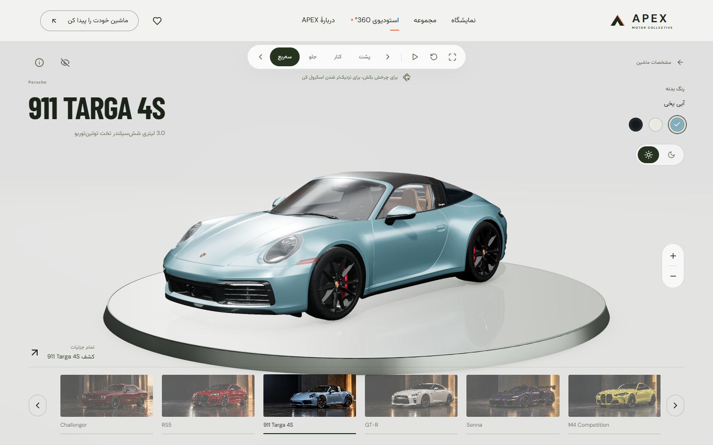](docs/screenshots/studio-day.png) |

- **رنگ و محیط:** سه انتخاب رنگ برای هر ماشین، استودیوی تاریک و محیط سفید روز
- **کنترل دوربین:** درگ، زوم، چهار زاویهٔ آماده، چرخش خودکار و بازنشانی نما
- **انتخاب ماشین:** عکس‌های بزرگ در نوار افقی، با درگ ماوس، لمس، چرخ ماوس یا دکمه‌های قبلی و بعدی
- **تمرکز روی ماشین:** پنهان کردن رابط با دکمهٔ چشم یا کلید **H**؛ بازگشت با دکمهٔ همیشه‌نمایان، **H** یا **Escape**
- **تمام‌صفحه:** مناسب نمایش و ضبط ویدیو، با حفظ امکان چرخاندن ماشین

<details>
<summary>حالت نمایش و ضبط؛ ماشین و استیج، بدون شلوغی رابط</summary>
<br />

[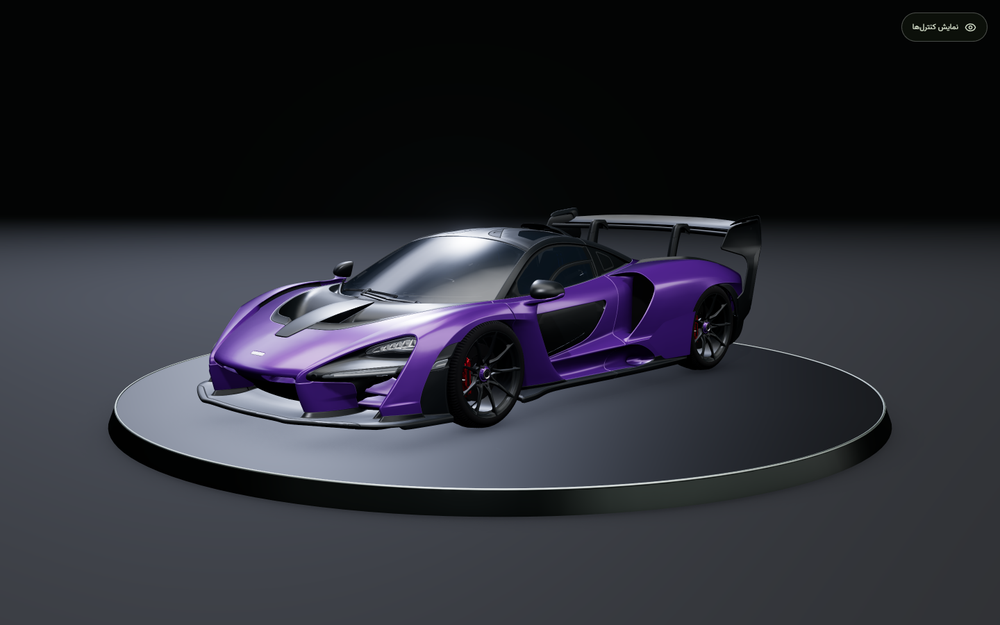](docs/screenshots/presentation.png)

</details>

### جزئیات ماشین؛ از حس طراحی تا مشخصات فنی

هر ماشین صفحهٔ خودش را دارد: تصویر تمام‌عرض، نشانگرهای عملکرد، توضیح طراحی، نقاط تعاملی مهندسی، گالری و دسته‌بندی مشخصات. منابع و مبنای اندازه‌گیری کنار اطلاعات آمده‌اند؛ برای مثال PS و SAE hp یا شتاب صفر تا 60 مایل با صفر تا 100 کیلومتر یکی در نظر گرفته نمی‌شوند.

| معرفی ماشین | نشانگرهای عملکرد |
| :---: | :---: |
| [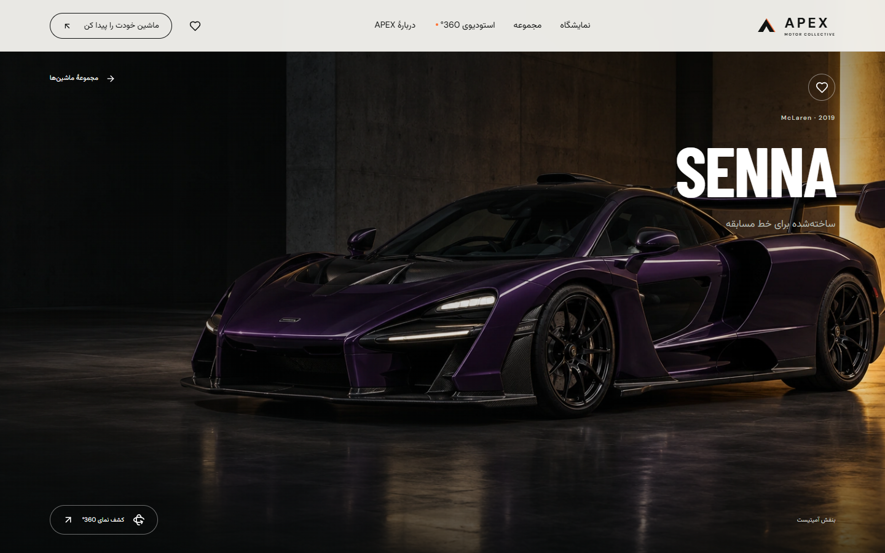](docs/screenshots/vehicle.png) | [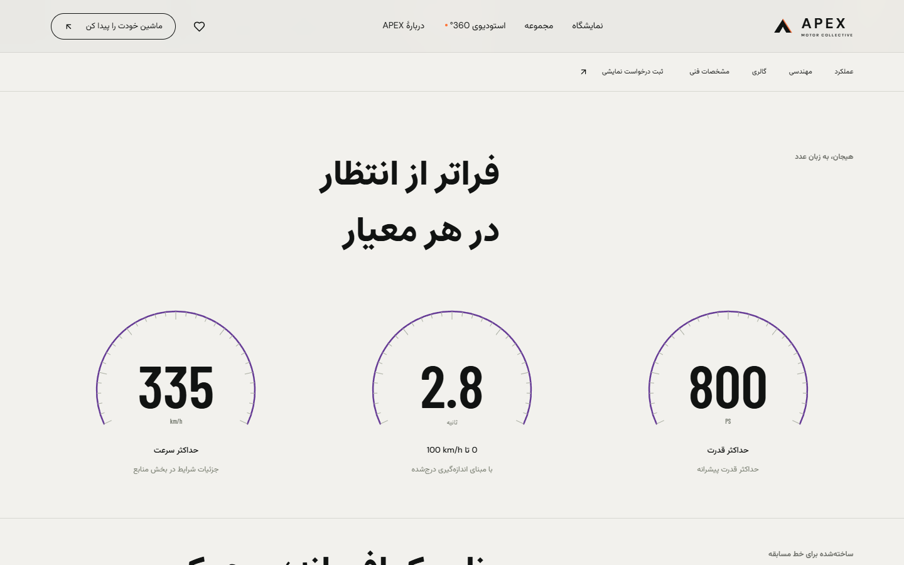](docs/screenshots/performance.png) |

| جزئیات تعاملی مهندسی | مشخصات دسته‌بندی‌شده |
| :---: | :---: |
| [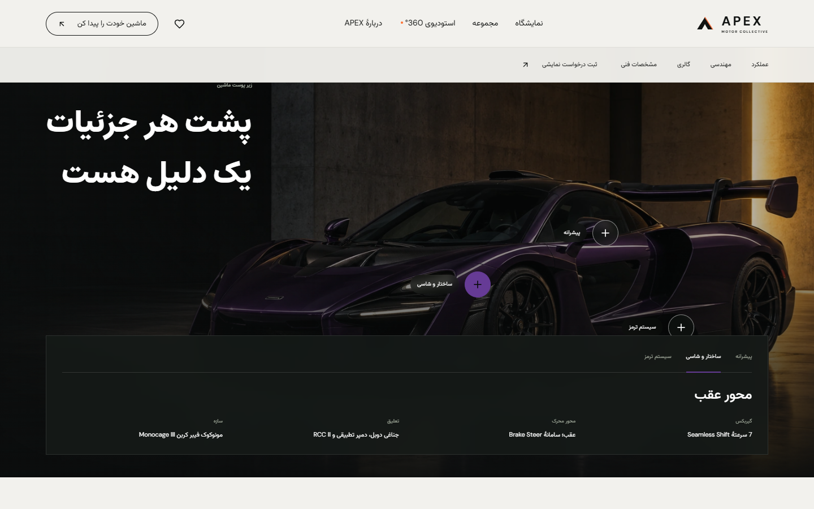](docs/screenshots/engineering.png) | [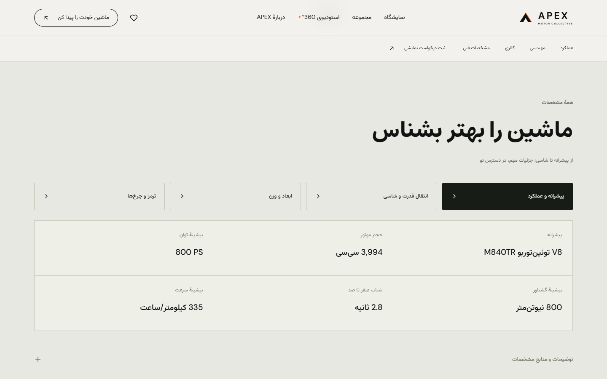](docs/screenshots/specifications.png) |

فرم درخواست، یک فایل نمایشی قابل‌دریافت می‌سازد؛ اطلاعات به نمایشگاه یا سروری ارسال نمی‌شود.

### مقایسه و داستان APEX

| ماشین‌ها کنار هم | دربارهٔ APEX |
| :---: | :---: |
| [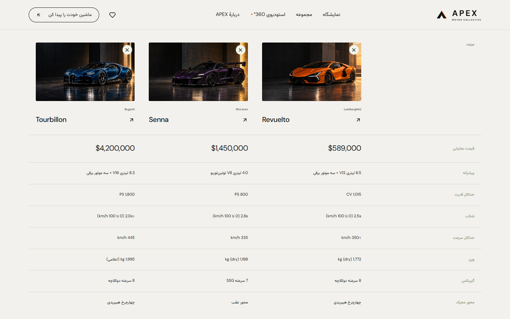](docs/screenshots/compare.png) | [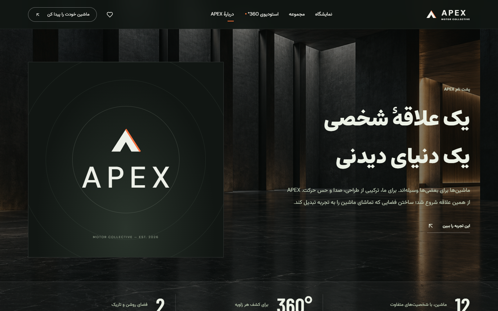](docs/screenshots/about.png) |

تا سه ماشین را برای مقایسه انتخاب کنید. صفحهٔ درباره، ایدهٔ پروژه، سازنده و هنرمندان مدل‌های سه‌بعدی را معرفی می‌کند.

<details>
<summary>ورود به استودیو از صفحهٔ اصلی و فوتر پروژه</summary>
<br />

[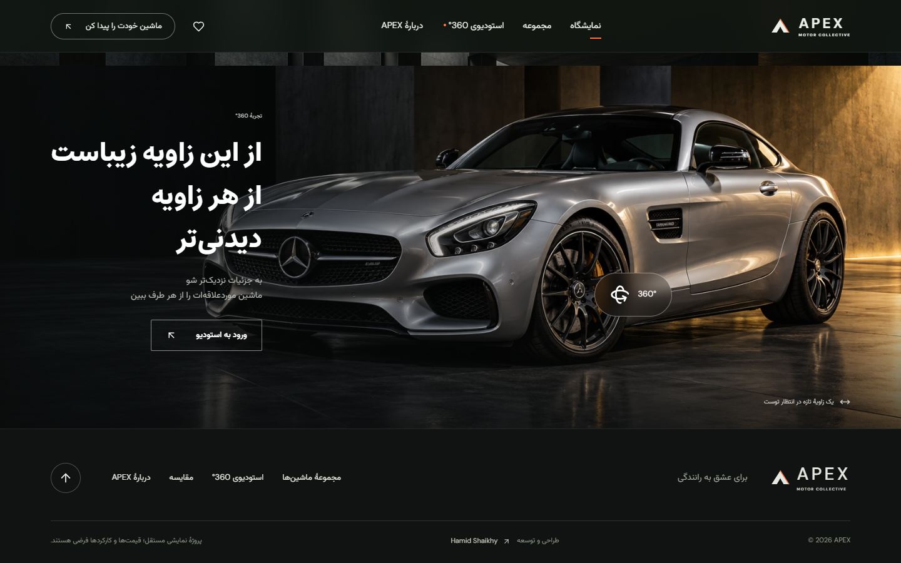](docs/screenshots/home-studio.png)

[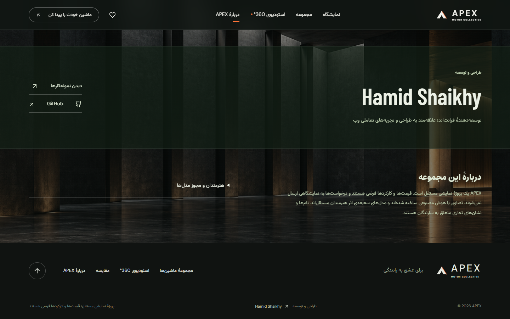](docs/screenshots/about-footer.png)

</details>

### تجربهٔ موبایل

| نمایشگاه | مجموعه | استودیوی 360° | درباره |
| :---: | :---: | :---: | :---: |
| [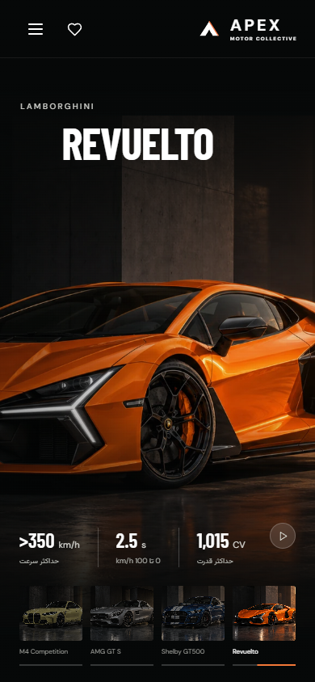](docs/screenshots/mobile-home.png) | [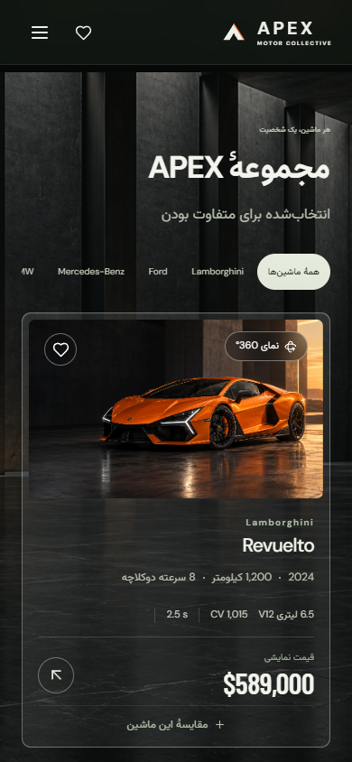](docs/screenshots/mobile-collection.png) | [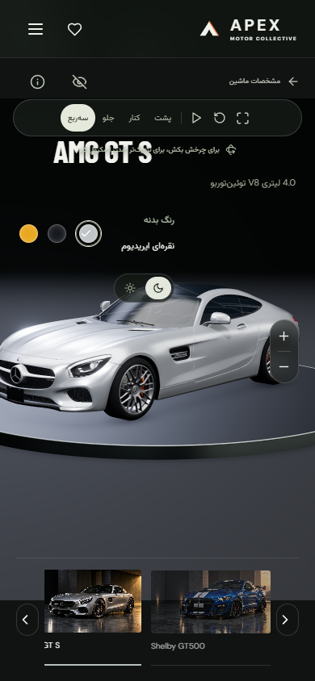](docs/screenshots/mobile-studio.png) | [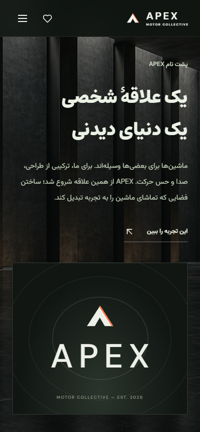](docs/screenshots/mobile-about.png) |

<a id="features"></a>
## امکانات اصلی

| بخش | امکانات |
| --- | --- |
| هیرو | چهار اسلاید منتخب، جابه‌جایی خودکار، تایم‌لاین با سرعت متغیر، انتخاب دستی و توقف پخش |
| مجموعه | 12 ماشین، جست‌وجوی مدل و پیشرانه، فیلتر برند، مرتب‌سازی، ذخیره در مرورگر و مقایسهٔ حداکثر سه ماشین |
| استودیوی سه‌بعدی | مدل‌های کامل، استیج دایره‌ای، تغییر رنگ، دو محیط نورپردازی، دوربین تعاملی و چرخش خودکار |
| جزئیات | نشانگرهای عملکرد، نقاط تعاملی مهندسی، گالری با بزرگ‌نمایی، تب‌های مشخصات و لینک منابع |
| نمایش و ضبط | لودینگ ورود، آماده‌سازی صحنه، تمام‌صفحه و پنهان‌کردن کنترل‌ها با راه بازگشت واضح |
| رابط | فارسی و RTL، فونت‌های Estedad و Vazirmatn، نام‌ها و عددهای انگلیسی، کارت‌های شیشه‌ای و انیمیشن اسکرول |
| دسترس‌پذیری | کنترل با کیبورد، وضعیت انتخاب‌ها، فوکوس قابل‌مشاهده و رعایت تنظیم کاهش حرکت |

<a id="collection"></a>
## ماشین‌های مجموعه

| برند | مدل |
| --- | --- |
| Lamborghini | Revuelto |
| Ford | Mustang Shelby GT500 |
| Mercedes-Benz | AMG GT S |
| BMW | M4 Competition |
| McLaren | Senna |
| Nissan | GT-R Premium R35 |
| Porsche | 911 Targa 4S |
| Audi | RS5 Coupe |
| Dodge | Challenger |
| Bugatti | Tourbillon |
| Aston Martin | One-77 |
| Rolls-Royce | Ghost |

مدل‌ها در مجموع حدود **4.96 میلیون مثلث** و **267 MB** حجم دارند. این نسخه با اولویت کیفیت تصویر برای دمو و ضبط ویدیو آماده شده است؛ هندسهٔ فایل‌های دریافتی ساده‌سازی نشده و بارگذاری اول می‌تواند زمان ببرد. جزئیات مدل‌های هنری ممکن است با تریم مرجعِ مشخصات کارخانه متفاوت باشد.

<details>
<summary>لودینگ و آماده‌سازی تجربه</summary>
<br />

[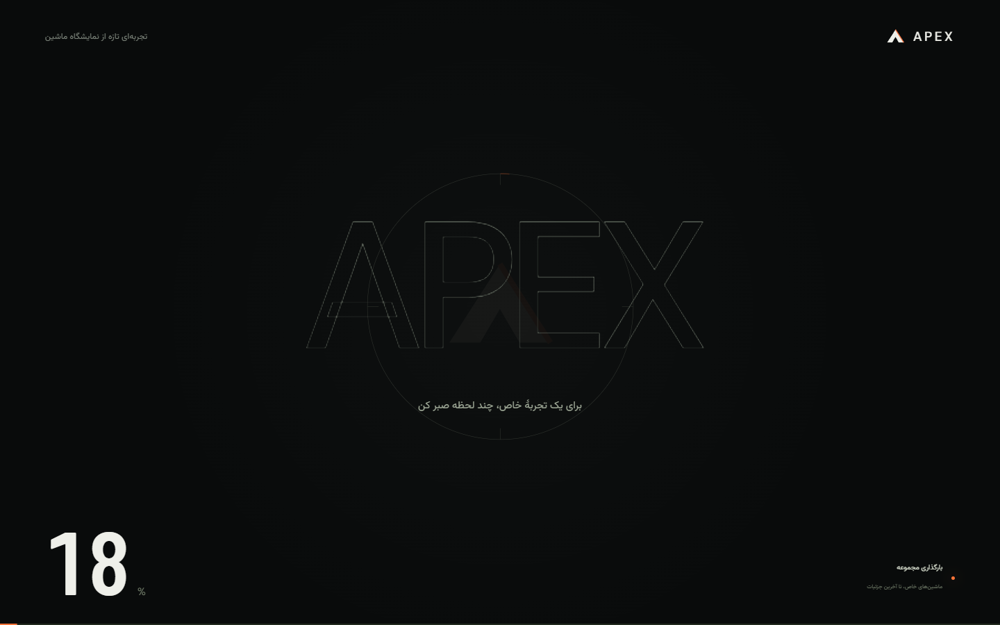](docs/screenshots/loading.png)

ورود اولیه، عکس‌ها، فونت‌ها و مدل‌ها را آماده می‌کند. لودینگ استودیو نیز تا آماده شدن صحنه و کامپایل شیدرها باقی می‌ماند.

</details>

<a id="getting-started"></a>
## شروع سریع

پیش‌نیاز: **Node.js 22 یا جدیدتر** و مرورگر دارای **WebGL 2**. برای تجربهٔ سه‌بعدی، شتاب‌دهی سخت‌افزاری مرورگر را فعال کنید.

```bash
git clone https://github.com/hamidshaikhy/apex-car.git
cd apex-car
npm ci
npm run dev
```

برنامه معمولاً در [localhost:5173](http://localhost:5173) باز می‌شود. بک‌اند، حساب کاربری یا کلید API لازم ندارد؛ مدل‌ها، تصاویر، فونت‌ها و دیکودرها داخل پروژه قرار دارند.

```bash
npm run build      # ساخت نسخهٔ نهایی در dist/
npm run preview    # پیش‌نمایش نسخهٔ ساخته‌شده
```

مسیریابی با HashRouter انجام می‌شود؛ مسیرهایی مثل `/#/studio?car=senna` روی میزبانی استاتیک هم به بازنویسی مسیر سمت سرور نیاز ندارند.

### کنترل‌های استودیو

| ورودی | عملکرد |
| --- | --- |
| درگ روی ماشین | چرخاندن دوربین |
| اسکرول یا حرکت دو انگشت | نزدیک و دور شدن |
| کلیدهای جهت | تغییر زاویهٔ آماده |
| `+` و `-` | زوم |
| `H` | پنهان یا نمایان کردن رابط |
| `Escape` یا دکمهٔ چشم | بازگشت از حالت نمایش به رابط کامل |

<a id="architecture"></a>
## ساختار و فناوری‌ها

| لایه | فناوری |
| --- | --- |
| رابط و مسیریابی | React 19، TypeScript، React Router و Vite |
| سه‌بعدی | Three.js، React Three Fiber و Drei |
| متریال و نور | متریال فیزیکی، Clearcoat، بازتاب، سایه و نورهای استودیویی |
| پردازش تصویر | Ambient Occlusion، Bloom و ACES Filmic Tone Mapping |
| انیمیشن | Framer Motion و Web Animations API |
| تایپوگرافی | Estedad، Vazirmatn، DM Sans و Barlow Condensed |
| بررسی | Vitest و اسکریپت مرورگر با Playwright و Brave |

```text
src/
  components/        صحنهٔ سه‌بعدی، کارت‌ها، پوسته و لودینگ
  pages/             نمایشگاه، مجموعه، جزئیات، استودیو، مقایسه و درباره
  data/              کاتالوگ، مشخصات، منابع و تنظیمات متریال هر ماشین
  lib/               بارگذاری مدل‌ها و منطق مشترک
  state.tsx          ذخیره‌ها، مقایسه و پیام‌های رابط
public/assets/
  models/hd/         مدل‌های کامل GLB
  editorial/         تصاویر ماشین‌ها و فضای معماری
  draco/             دیکودرهای محلی
docs/screenshots/    تصاویر واقعی README
scripts/            ثبت تصاویر و بررسی مدل‌ها و تجربه
tests/              بررسی دارایی‌ها و یکپارچگی کاتالوگ
```

### بررسی و ثبت دوبارهٔ تصاویر

```bash
npm test
npm run build
```

برای ثبت تصاویر این README، برنامه را اجرا کنید و در ترمینال دیگری بزنید:

```bash
node scripts/capture-readme.mjs
```

این اسکریپت از Brave استفاده می‌کند. اگر مسیر نصب متفاوت است، متغیر `APEX_BROWSER_EXECUTABLE` را تنظیم کنید؛ برای تغییر آدرس برنامه از `APEX_PREVIEW_URL` استفاده کنید. تصاویر در `docs/screenshots/` ذخیره می‌شوند.

بررسی کامل مرورگر به‌صورت جداگانه با `node scripts/verify-persian.mjs` انجام می‌شود. دامنهٔ بررسی‌ها و محدودیت اندازه‌گیری عملکرد GPU در [گزارش بررسی](docs/VERIFICATION.md) آمده است.

## مستندات و منابع

| موضوع | فایل |
| --- | --- |
| اطلاعات ماشین‌ها و منابع مشخصات | [src/data/vehicles.json](src/data/vehicles.json) |
| سازندگان و مجوز مدل‌ها، تصاویر و فونت‌ها | [ASSET_CREDITS.md](ASSET_CREDITS.md) |
| تعداد مثلث‌ها و مشخصات فایل مدل‌ها | [public/assets/models/manifest.json](public/assets/models/manifest.json) |
| تصاویر تولیدشده و پرومپت‌ها | [docs/IMAGE_PROMPTS.md](docs/IMAGE_PROMPTS.md) |
| راهنمای فارسی اجرا و ضبط | [README.fa.md](README.fa.md) |

## سازنده و مجوز

**Hamid Shaikhy · حمید شیخی**<br />
[GitHub](https://github.com/hamidshaikhy) · [Portfolio](https://hamidshaikhy.vercel.app/) · [LinkedIn](https://www.linkedin.com/in/hamid-shaikhy/)

کد با مجوز [MIT](LICENSE) ارائه شده است. مدل‌های سه‌بعدی و سایر دارایی‌ها مجوز مستقل خودشان را دارند؛ اعتبارها و جزئیات در [ASSET_CREDITS.md](ASSET_CREDITS.md) ثبت شده‌اند. نام‌ها و نشان‌های تجاری متعلق به سازندگان خودرو هستند.
